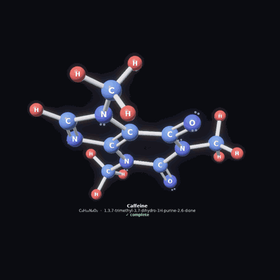
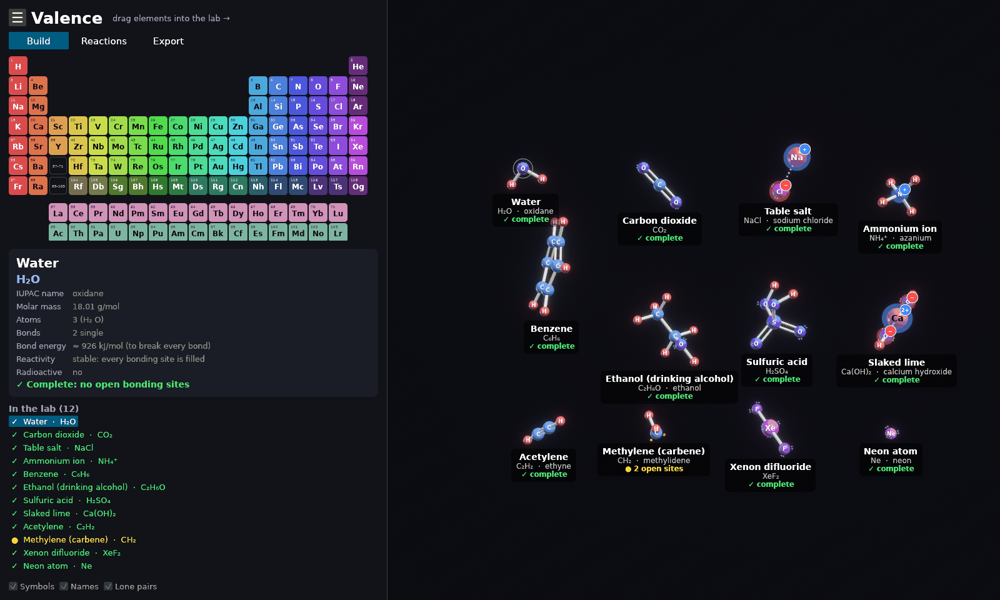
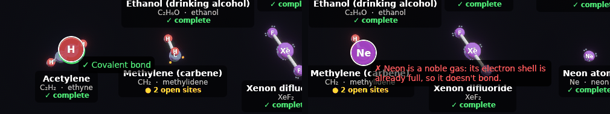
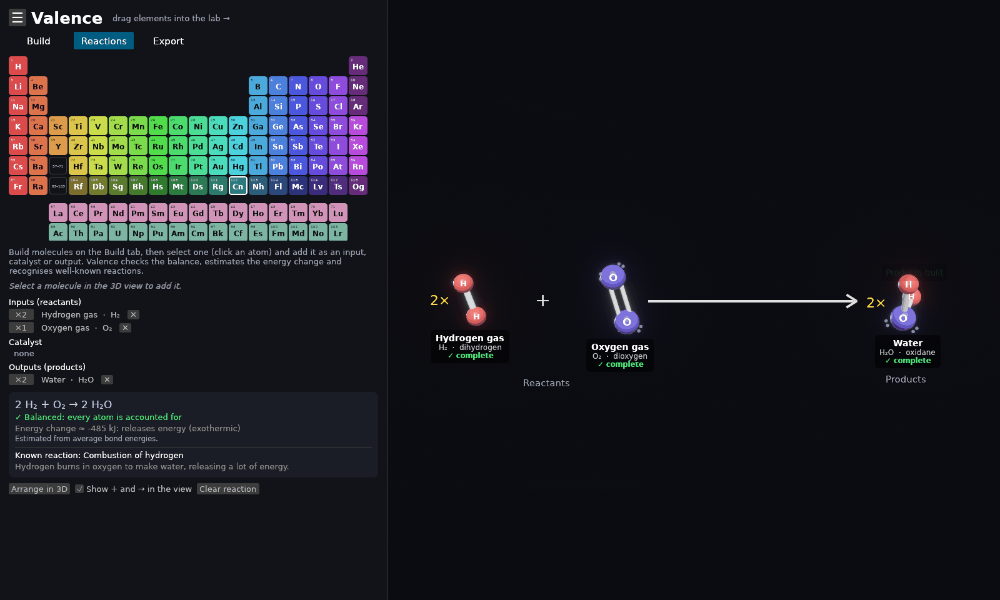
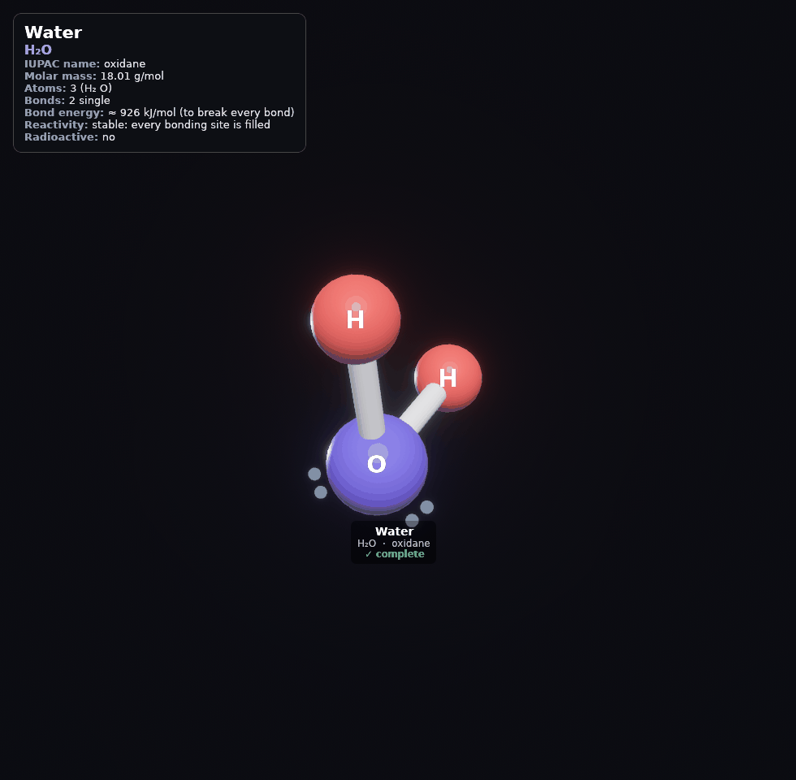
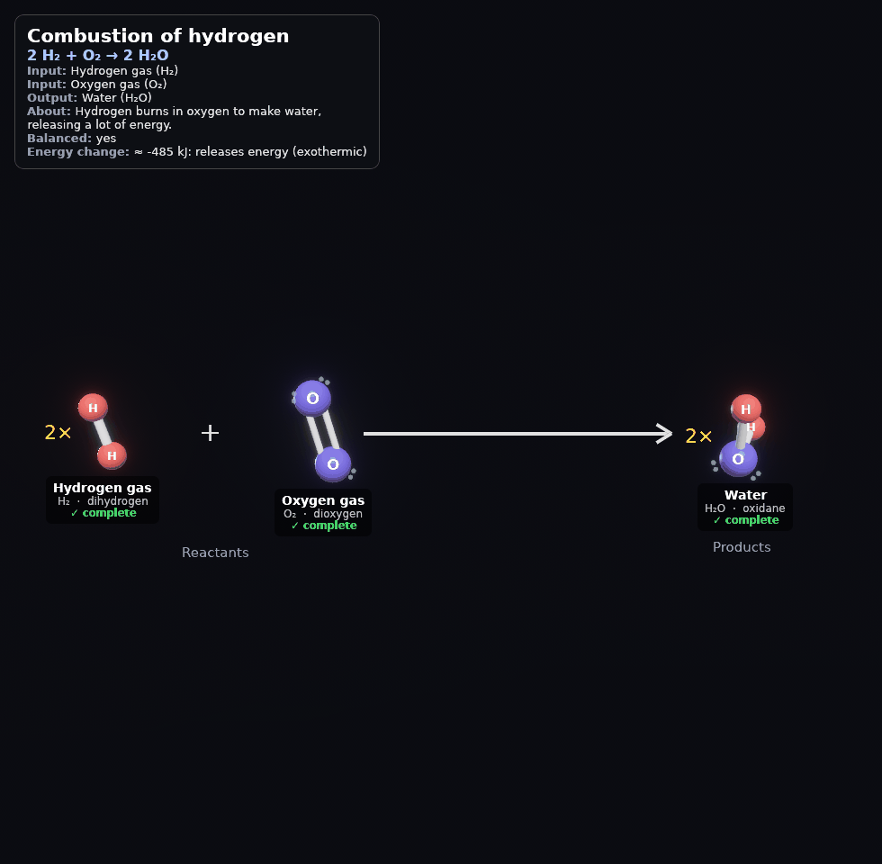
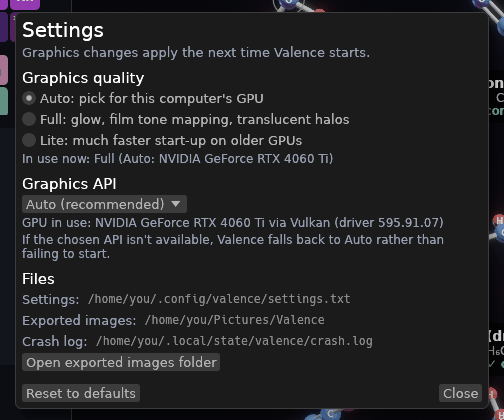

# Valence

**Build molecules in 3D and see how chemistry fits together.**

Valence is an educational app for experimenting with atoms and molecules.
Drag elements out of the periodic table, drop them onto each other, and watch
real bonding rules decide what can join. Each molecule gets its proper
name, its 3D shape, and the facts that go with it.

  

## What you can do

- **Build anything from the whole periodic table.** Valence uses simplified
  but realistic rules. Carbon makes four bonds, oxygen two; sodium hands an
  electron to chlorine to make table salt; neon won't bond with anything.
- **See bonds and electrons.** Single, double and triple bonds, ionic bonds,
  lone pairs, open bonding sites and ion charges are all drawn in 3D.
- **Get real names.** Everyday and official (IUPAC) names, e.g. *Water*
  (oxidane), *Table salt* (sodium chloride), *Isopropyl alcohol*
  (propan-2-ol).
- **Explore the facts.** Formula, molar mass, bond types, estimated bond
  energy, reactivity, and whether anything in it is radioactive.
- **Set up reactions.** Check whether they balance, balance them
  automatically, estimate whether they release or absorb energy, and
  recognise famous reactions like combustion, photosynthesis and the Haber
  process.
- **Pick from the Library.** Search 100+ ready-made compounds by name or
  formula and add them with one click, or save your own creations to
  **My molecules**.
- **Save your work.** Save the whole lab (molecules, reactions and your
  own Library entries) to a file and open it again later.
- **Export pictures** of your build, a single molecule with a fact card, or a
  whole reaction, ready for notes, slides or worksheets.

## Download

Get the latest version from the **[Releases](https://github.com/rallegretti/Valence/releases)**
page (also linked on the right side of this page). Nothing else needs
installing: no .NET, Java or other runtimes.

| Your system | Download | Then |
|---|---|---|
| **Windows** 10 or 11 | `Valence-…-windows-x86_64.zip` | Unzip it and run **Valence.exe** (see the heads-up below) |
| **macOS** 11 or later (Apple Silicon and Intel) | `Valence-…-macos-universal.dmg` | Open it and drag **Valence** onto **Applications** |
| **Ubuntu, Debian, Mint, Pop!_OS** | `valence_…_amd64.deb` | Double-click to install, or `sudo apt install ./valence_…_amd64.deb`; Valence then appears in your apps menu |
| **Other Linux** | `Valence-…-x86_64.AppImage` | Make it executable (file properties, or `chmod +x Valence-*.AppImage`) and run it |

The Linux downloads work on Ubuntu 22.04 or newer, Debian 12 or newer, and
other 64-bit distributions from 2022 on.

**What you need:** a graphics card with up-to-date drivers. Nearly any
computer from the last ten years works; older ones can use the faster
**Lite** graphics mode (see Troubleshooting).

**Windows heads-up:** the Windows build isn't code-signed yet, so Windows may
warn you the first time you open Valence:

- **"Windows protected your PC"** (SmartScreen): click **More info**, then
  **Run anyway**. You only need to do this once.
- **Windows 11 with Smart App Control on** blocks unsigned apps outright, with
  no "run anyway" option. You can wait for a signed release, or turn Smart App
  Control off (Windows Security → App & browser control → Smart App Control
  settings). Be aware that on some versions of Windows it can't be turned back
  on afterwards without resetting Windows.

Want to build it yourself? See the [build instructions](docs/DEVELOPMENT.md#building).

## A quick tour

**New here?** Open **☰ → File → Open example shelf** to load a dozen
example molecules to explore.

### Building molecules

Drag an element from the periodic table into the dark 3D area to drop an
atom. Then drag more elements **onto** it. Before you let go, Valence tells
you whether the bond can form:

- A **green ring** means it will bond, and says what kind of bond.
- A **red ring** explains why it won't.

**Click instead of drag:** select an atom, then click elements in the table
to keep building onto it. To join two molecules, drag an atom of one onto an
atom of the other. Hold **Shift** while dragging to move a single atom,
which is how you close a ring like benzene.

Bond types sort themselves out. Two oxygens become O=O, two nitrogens become
N≡N, and adding hydrogen to acetylene turns its triple bond into a double,
then a single.

### Reading the 3D view

| What you see | What it means |
|---|---|
| Coloured spheres | Atoms, coloured by their column in the periodic table |
| One / two / three white tubes | Single / double / triple bond |
| Dotted line of beads | Ionic bond (an electron passed from a metal to a nonmetal) |
| Bright yellow dots | Open bonding sites: the atom can still bond here |
| Pale pairs of dots | Lone pairs (electrons not used in bonds) |
| Blue glow or ring, **+** badge | Positive ion (cation) |
| Red glow or ring, **−** badge | Negative ion (anion) |
| ✓ complete | Every bonding site is filled: a stable molecule |
| ● 2 open sites | Still reactive: it could bond further |

Click any atom to see that molecule's details in the sidebar: names, formula,
mass, bonds, energy and more.

### The Library

The **Library** sits on the right edge of the 3D area. Click **▶** to tuck it
away and the **◀ Library** tab to bring it back.

- **Search** by everyday name, IUPAC name or formula: `water`, `ethanoic`,
  `H2O` and `H₂O` all work.
- **Add** drops the molecule into an empty spot in the lab.
- **My molecules:** select a molecule in the lab, give it a name and click
  **Save** to keep it in the Library. Rename (✎) or remove (✕) entries any
  time. They're saved with your lab data file.

### Saving and opening your work

**☰ → File → Save Lab Data** saves everything in one `.valence` file: the
molecules and where they sit, your reactions, your **My molecules** list and
the camera view. **Open Lab Data…** brings it all back.

- The first save asks where to put the file. After that, **Save** updates
  the same file (or the file you opened); use **Save Lab Data As…** to make a
  copy somewhere else.
- The window title shows the file's name, with a **•** when there are
  unsaved changes. Valence asks before anything would throw them away: a new
  lab, opening another file, or quitting.
- **Saving is safe.** The new version is written to a temporary file, read
  back and checked, and only then swapped in place of the old one. If
  anything goes wrong (disk full, unplugged drive), the old file is left
  exactly as it was. The previous version is also kept next to it as
  `yourfile.valence.bak`.
- **Opening is safe too.** The whole file is read and checked before your
  current lab is touched. A damaged file is refused with a message and
  nothing changes. Opening a file can be undone with **Ctrl/Cmd + Z**.

### Reactions

On the **Reactions** tab, select molecules and add them as **inputs**,
**catalysts** or **outputs**. Valence then:

- writes the equation and checks every atom is accounted for;
- offers **Balance the coefficients** when it doesn't balance;
- estimates the **energy change** (does it release or absorb energy?);
- recognises well-known reactions, checks for the right catalyst, and can
  **build the products** for you;
- **Arrange in 3D** lays it all out left to right with "+" and "→".

Valence can't predict the products of *any* combination; real chemistry is
far too varied for that. For reactions outside its library, you build the
products and Valence checks your work.

### Exporting pictures

The **Export** tab saves a PNG of the whole build area, the selected
molecule, or the current reaction. A details card is optional. Images are
saved in your **Pictures/Valence** folder.

  
  &nbsp;
  

### Menu and settings

The **☰** button next to the title holds the menus:
- **File:** new lab, open / save lab data, example shelf, export, quit
- **Edit:** undo, redo, delete an atom or a whole molecule
- **Settings**
- **Help:** a controls cheat-sheet

**Graphics quality:**
- **Full** adds glow and translucent effects.
- **Lite** starts much faster on older computers. It changes how a few
  effects look, nothing else.
- **Auto** (the default) picks the right one for your graphics card.

## Controls

| To do this | Do this |
|---|---|
| Add an atom | Drag an element from the table into the 3D area |
| Bond a new atom | Drag an element onto an atom |
| Build by clicking | Select an atom, then click elements |
| Move a molecule | Drag one of its atoms |
| Join two molecules | Drag an atom onto an atom of the other molecule |
| Move one atom (close a ring) | **Shift** + drag the atom |
| Rotate the view | Drag empty space, or right-drag |
| Pan the view | **Shift** + drag empty space, or middle-drag |
| Zoom | Scroll, or pinch on a trackpad |
| Remove an atom or molecule | Right-click it, or select it and press **Delete** / **Backspace**. If the atom is bonded to others, choose **Just this atom** (**A**) or **Whole molecule** (**M**) |
| Undo / redo | **Ctrl/Cmd + Z** / **Ctrl/Cmd + Shift + Z** |
| Save lab data / save as | **Ctrl/Cmd + S** / **Ctrl/Cmd + Shift + S** |
| Open lab data | **Ctrl/Cmd + O** |
| New lab | **Ctrl/Cmd + N** |
| Fit everything in view | **F** |
| Cancel a drag | **Esc** |

The same list is in the app under **☰ → Help → Controls**.

## Troubleshooting

**The window stays dark for a long time, or the app feels slow.**
Older graphics chips, especially Intel integrated graphics from before about
2020, need time to prepare 3D graphics. The periodic table appears first and
the 3D area shows *Preparing 3D graphics…* while it works. Switch to
**Lite** in **☰ → Settings** for a much faster start next time. Valence also
offers this itself if the start-up was slow.

**Windows won't open Valence.**
The Windows build isn't code-signed yet; see the Windows heads-up under
[Download](#download) for the one-time steps to allow it.

**Where are my files?**

| | Windows | macOS | Linux |
|---|---|---|---|
| Lab data files | Wherever you save them (plus a `.bak` copy of the previous version) | same | same |
| Exported images | `Pictures\Valence` | `~/Pictures/Valence` | `~/Pictures/Valence` |
| Settings | `%APPDATA%\Valence` | `~/Library/Application Support/Valence` | `~/.config/valence` |
| Crash log | `%LOCALAPPDATA%\Valence` | `~/Library/Logs/Valence` | `~/.local/state/valence` |

**Something went wrong.**
Valence is designed not to crash: if an action hits a problem, it's undone
and you'll see *"Something went wrong, so that change was undone."* Details
are written to the crash log above. Please
[open an issue](https://github.com/rallegretti/Valence/issues) and attach it.

## About the chemistry

Valence uses a **simplified valence model**, the kind of rules taught in
school chemistry. It gets a great many things right:
- how many bonds each element makes, including the extra bonds of sulfur,
  phosphorus and xenon;
- single, double and triple bonds;
- ionic salts and charged ions such as ammonium (NH₄⁺);
- molecule shapes from electron-pair repulsion (VSEPR): tetrahedral methane,
  bent water, linear CO₂, flat benzene and caffeine.

It doesn't cover everything:
- molecules whose usual picture needs "resonance" charges (nitrate, ozone);
- metal complexes;
- mirror-image (chiral) forms.

Energy values are estimates from average bond energies, good for comparing
and for telling exothermic from endothermic, but not lab-precise.

## For developers

Architecture, the stability design, platform notes and the test tools are in
[docs/DEVELOPMENT.md](docs/DEVELOPMENT.md).

Fonts: DejaVu Sans (see `assets/fonts/LICENSE-DejaVu.txt`).
