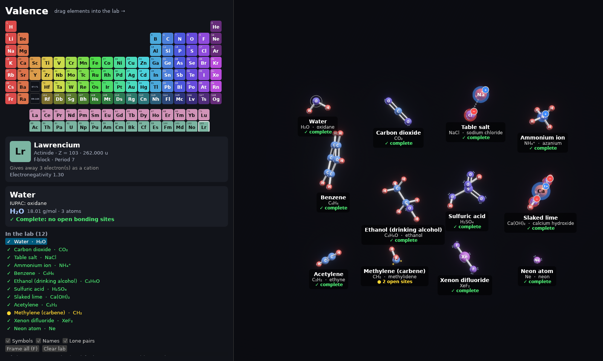

# Valence

A 3D molecule-building game. Drag elements out of the periodic table into the
lab, drop more elements onto atoms to bond them, and watch the molecule take
shape, with its common and IUPAC names.



```
cargo run --release            # play
cargo run --release -- --demo  # start with a shelf of example molecules
cargo test --workspace         # rules, naming, layout, stress and crash-rollback tests
cargo build --profile dist     # optimised shipping build → target/dist/
```

Runs on Windows, macOS (Apple Silicon and Intel) and Linux (X11 or Wayland).
Requires Rust 1.95+. Linux builds also need `pkg-config libx11-dev
libxkbcommon-dev libwayland-dev` (Debian/Ubuntu names); Windows and macOS need
nothing beyond Rust. No C compiler is required on any platform.

## How to play

| Action | Result |
| --- | --- |
| Drag an element into empty space | Drops a free atom |
| Drag an element onto an atom | Bonds it, if chemistry allows. Green ring = OK, red ring + reason = not allowed |
| Select an atom, then click elements | Builds onto the selected atom without dragging |
| Drag an atom | Moves its molecule; drop it on another atom to bond the two |
| Shift + drag an atom | Moves just that atom (use it to close rings, e.g. benzene) |
| Drag empty space / Shift + drag empty space | Orbit / pan (works on trackpads) |
| Right-drag / middle-drag | Orbit / pan |
| Scroll or pinch | Zoom |
| Right-click, Delete or Backspace on an atom | Removes it (Delete/Backspace also acts on the selected atom) |
| Ctrl/Cmd + Z, Ctrl/Cmd + Shift + Z (or Ctrl + Y) | Undo / redo (also buttons in the panel) |
| F | Frame everything |
| Esc | Cancel a drag |

**Visual language**

- Atoms are spheres coloured by periodic-table column (f-block has its own two colours).
- Bonds are white tubes: one tube = single, two = double, three = triple.
  Ionic bonds are a dotted line of beads.
- Bright yellow dots are open bonding sites (unpaired electrons); pale pairs
  of dots are lone pairs.
- Ions glow (blue = cation, red = anion) and carry a charge badge.
- Every molecule has a tag with its name, formula, IUPAC name, and whether
  it is **complete** (no open bonding sites).

## Chemistry model

A simplified but grounded valence model, in `crates/chem`:

- **Valence capacity**: each element has its allowed valences (C 4; N 3;
  O 2; P 3/5; S 2/4/6; Cl 1/3/5/7; Xe 0/2/4/6; metals use common oxidation
  states). An atom uses the smallest that fits and expands when needed, so
  SO₂ → SO₃ and PCl₃ → PCl₅ work.
- **Bond orders are solved, not chosen**: after each change, a maximum
  b-matching (greedy plus augmenting paths) raises bond orders to fill open
  sites. O + O becomes O=O, N + N becomes N≡N, and adding H to acetylene
  hydrogenates it to ethene and then ethane.
- **Ionic vs covalent**: alkali and alkaline-earth metals (except Be), or any
  metal–nonmetal pair with ΔEN ≥ 1.7, transfer electrons and form ions
  (NaCl, MgO, Ca(OH)₂). Metal + metal is rejected (that would be an alloy).
- **Protonation**: H on a full N/O/P/S with a lone pair makes an -onium ion
  (NH₄⁺, H₃O⁺).
- **Refusals** are explained: noble gases, superheavy elements, Kr/Xe/Rn
  partner limits, full octets, metals out of electrons.
- **Geometry**: VSEPR-style electron-domain repulsion plus bond springs gives
  tetrahedral CH₄, bent H₂O, linear CO₂ and XeF₂, and planar benzene.

Not modelled: formal-charge resonance structures (so nitrate and ozone can't be
built), coordination complexes, and stereochemistry.

## Naming

1. **Curated table** (`compounds.rs`, ~120 entries as SMILES), matched by a
   structure hash (Weisfeiler–Lehman with aromatic perception). Build order
   doesn't matter, and isomers stay distinct (ethanol vs dimethyl ether).
2. **Ionic compounds**: cation and anion names with Roman numerals and
   polyatomic anions (calcium carbonate, iron(III) chloride, Ca(OH)₂).
3. **Binary covalent**: Greek prefixes (dinitrogen tetroxide, sulfur hexafluoride).
4. **Organic** (`organic.rs`): IUPAC-style names for acyclic and monocyclic
   hydrocarbons, including benzene, with alkyl, halo and hydroxy groups,
   ene/yne, and -ol (e.g. 3-ethyl-2-methylpentane, propan-2-ol,
   1,2-dichlorobenzene).

## Stability ("no-crash" design)

- **The core never panics.** `crates/chem` and the app deny `unwrap`, `expect`,
  `panic!` and `unreachable!` outside tests (enforced by clippy). Every lookup
  is checked, every search is bounded (the bond solver is polynomial, not
  exponential), positions are protected from NaN/∞, and the lab is capped at
  2000 atoms.
- **Every edit is transactional.** Player actions go through `Chem::edit`,
  which snapshots the lab and runs the change under `catch_unwind`. A
  rejected action changes nothing. If an unknown bug panics, the lab rolls
  back, the player sees "that change was undone", and the game keeps running.
  Physics and naming are guarded the same way (naming falls back to the formula).
- **Crash log.** Any panic is appended, with a backtrace, to
  `%LOCALAPPDATA%\Valence\crash.log` (Windows),
  `~/Library/Logs/Valence/crash.log` (macOS), or
  `~/.local/state/valence/crash.log` (Linux).
- **Bevy errors are warnings.** A failing system logs instead of quitting
  (`set_error_handler(warn)`). Minimised or tiny windows get a safe viewport,
  and the window has a minimum size.
- **Tested hard.** `crates/chem/tests/stress.rs` runs 300,000 random player
  actions (including garbage input such as invalid elements, dead atom ids
  and NaN positions) and checks every invariant after each one. A dense fused
  carbon sheet exercises the solver's worst case. Separate tests prove that a
  panicking edit rolls back cleanly and that undo/redo works.
- Release builds unwind on panic (so the guard can catch it). The Windows
  release build is a GUI app with no console window.

## Checking a platform locally

All building and testing happens on your own machines; nothing uses hosted CI.

- **macOS / Linux:** `scripts/check.sh`
- **Windows (PowerShell):** `.\scripts\check.ps1`

Each script runs format, clippy (warnings are errors), the full test suite and
the `dist` build. It then launches the game, renders the demo scene, saves a
screenshot and exits. A pass means the binary builds, starts, draws and shuts
down cleanly on that machine.

From Linux you can also compile-check the other platforms without their SDKs:

```
rustup target add x86_64-pc-windows-msvc aarch64-apple-darwin
cargo check --workspace --all-targets --target x86_64-pc-windows-msvc
cargo check --workspace --all-targets --target aarch64-apple-darwin
```

## Architecture

```
crates/chem   engine-independent core (no Bevy): elements, Lab (rules + solver),
              layout (physics), naming, SMILES, structure hashing. Unit-tested.
src/          Bevy 0.20 front end
  scene.rs     mirrors Lab → entities; structure rebuilt only on change,
               transforms written only while something moves
  interact.rs  ray picking, drag & drop, drop-feedback cache
  ui.rs        egui periodic table, info cards, 2D overlays (symbols, badges, tags)
  camera.rs    orbit camera confined to the right-hand viewport
  state.rs     Chem resource: transactional edits, undo/redo, cached names
  crash.rs     panic hook → crash log, catch_unwind guard
  debug.rs     --demo scene, VALENCE_SCREENSHOT / VALENCE_ZOOM / VALENCE_WINDOW / VALENCE_FAKE_DRAG
scripts/      check.sh (macOS/Linux) and check.ps1 (Windows) local verification
```

Performance notes:
- The lab sleeps when the layout settles, so an idle scene does no physics and
  no transform writes.
- Repulsion uses a uniform grid (O(n)). About 0.4 ms per frame for 1000 atoms
  (`cargo test -p valence_chem --release perf -- --ignored --nocapture`).
- Names and molecules are recomputed only when the lab's revision changes;
  drop checks are cached per (target, element, revision).
- Meshes and materials are shared; one material per element.
- Only the Bevy features in use are compiled (no audio, gamepad, glTF, scenes
  or bevy_ui), which means fewer system dependencies and faster builds.
- Full frame rate while focused, throttled to about 10 fps in the background.

Fonts: DejaVu Sans (see `assets/fonts/LICENSE-DejaVu.txt`).
